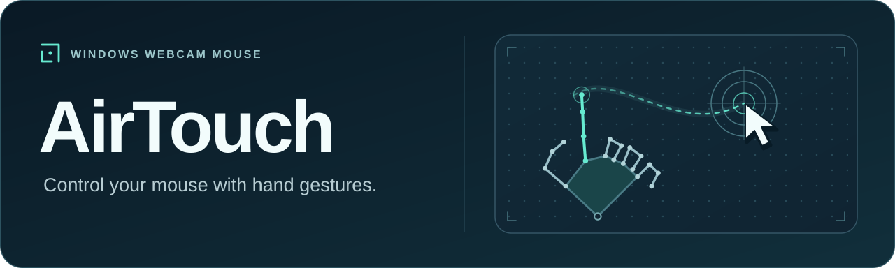
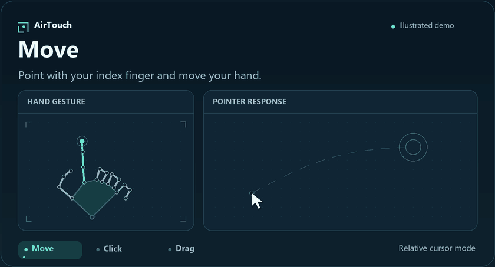

<p align="center">
  
</p>

# AirTouch

**Move, click, and drag on Windows with hand gestures and an ordinary webcam.** AirTouch is an independent computer vision prototype built with Python, MediaPipe and OpenCV. It tracks hand landmarks locally and translates gestures into mouse input across Windows apps.




*Illustrated walkthrough in relative cursor mode. This is not live webcam footage.*

## Get started

You need **Windows 10 or 11**, **64-bit Python 3.12**, and a working webcam. The first setup needs internet access to install dependencies and download the MediaPipe hand model.

1. [Download the source ZIP](https://github.com/khaichonggg/AirTouch/archive/refs/heads/main.zip) and extract it.
2. Double-click **`setup.bat`**. Wait for the setup to finish.
3. Double-click **`tray.bat`**. Find the grey hand icon in the Windows notification area (check the **^** menu if it is hidden) and click it to turn tracking on. The icon turns teal.
4. Click the hand icon again to pause tracking and release the camera. Right-click it and choose **Quit** to exit.

> Prefer to see what the camera sees? Start **`run.bat`** instead of `tray.bat`. Press **Q** or **Esc**, or close the preview window, to quit. Start only one mode at a time.

## Gestures

| Action | Gesture |
| --- | --- |
| Move | Point your index finger and move your hand. |
| Left-click | Briefly pinch thumb and index finger, then release. |
| Drag | Hold the thumb–index pinch until the button engages. Move your hand, then release to drop. |
| Right-click | Briefly pinch thumb and middle finger, then release. |
| Scroll | Raise index and middle fingers in a V, then move vertically. |
| Pause movement | Make a fist, or turn tracking off from the tray. |

AirTouch defaults to **absolute** cursor mapping. To try the **relative** movement shown above, copy `config.example.json` to `config.json`, set `"cursor_mode": "relative"`, and restart. Keep your hand in frame and start in good lighting. A short tap clicks; a sustained pinch drags.

## How it works

```text
Webcam → MediaPipe hand landmarks → gesture recognition → Windows mouse input
```

- The default gesture engine uses rules and runs on-device. An optional classifier can be trained locally; no classifier weights are bundled.
- The tray starts with tracking off. When tracking is on, the app reads frames locally. The standard workflow does not upload or record webcam video. The tray writes diagnostic logs locally.
- This is a prototype. Lighting, camera frame rate, and how clearly the fingers are visible affect responsiveness and accuracy.

## Run the checks

From PowerShell in the extracted folder, after setup:

```powershell
.\.venv\Scripts\python.exe -m pytest -q
.\.venv\Scripts\python.exe simulate.py --quiet --no-render --engine rule
```

The simulator uses synthetic gestures and does not control the real pointer. The tests exercise gesture recognition, input cleanup, and camera and tray recovery. To try the optional local classifier:

```powershell
.\.venv\Scripts\python.exe -m ml.train_model --synthetic 300
.\run.bat --engine ml
```

## Credits

AirTouch by **Khaichong Ew**. The [MediaPipe Hand Landmarker](https://ai.google.dev/edge/mediapipe/solutions/vision/hand_landmarker) model is downloaded separately during setup; third-party packages and models retain their respective licenses.
