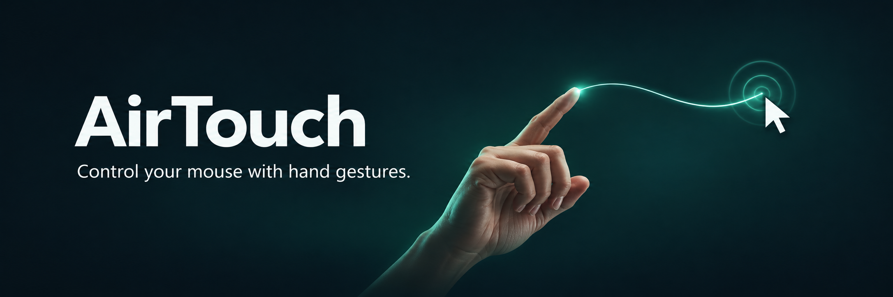

<p align="center">
  
</p>

# AirTouch — Webcam Gesture Mouse for Windows

**Turn a regular webcam into a hands-free mouse for Windows.** Point to move the cursor, tap your fingers together to click, and hold the pinch to drag. AirTouch sends standard mouse input, so you can try it in the Windows apps you already use.


https://github.com/user-attachments/assets/b2bc5bae-709a-4629-b632-84941c8c85fd

[v2.0.0 Preview](https://github.com/khaichonggg/AirTouch/releases/tag/v2.0.0-preview) · [Download source ZIP](https://github.com/khaichonggg/AirTouch/archive/refs/tags/v2.0.0-preview.zip) · [Install from CMD](#install-from-windows-cmd) · [Learn the gestures](#gestures) · [Troubleshoot](#troubleshooting)

## Why AirTouch?

- **Use the webcam you already have.** No special controller, depth camera, or wearable. A built-in or USB webcam is enough to get started.
- **Switch it on when you need it.** The tray icon starts off. One click turns tracking on, and another turns it off and releases the camera. Tray mode needs no open preview window.
- **Keep the pointer responsive.** The camera runs on a background thread. AirTouch processes the latest new frame instead of working through a queue of old frames. Cursor smoothing helps tame small hand movements. Actual responsiveness depends on your webcam, lighting, and computer.
- **Choose how the pointer moves.** Absolute mode maps your hand position to the screen. Relative mode works more like a touchpad: move your finger a little to move the cursor a little.
- **Keep video on your computer.** The standard workflow processes webcam frames locally without recording or uploading video. The first setup needs internet access to install libraries and download the hand tracking model.

## What you need

- **Windows 10 or 11**, 64-bit.
- **[Python 3.12 for Windows](https://www.python.org/downloads/windows/)**, 64-bit. In the Python installer, enable **Add python.exe to PATH** and keep the Python launcher enabled if offered.
- A working webcam and permission for desktop apps to access it.
- Internet access for the first setup. Git is optional.

## Quick install: double-click

1. [Download AirTouch](https://github.com/khaichonggg/AirTouch/archive/refs/tags/v2.0.0-preview.zip) and **extract the ZIP** to a normal folder. Open the extracted folder containing `install.py` and `setup.bat`.
2. Double-click **`setup.bat`**. It creates a local Python environment, installs the required libraries, and downloads the hand tracking model. Wait for setup to finish.
3. Double-click **`tray.bat`**. Look for a **grey hand** in the Windows notification area (check the **^** overflow menu). Click it to start tracking. It turns **teal**.
4. Click the hand icon again to turn tracking off. To close AirTouch completely, right-click the hand and select **Quit**.

 **Off** &nbsp;&nbsp;  **On**

## Install from Windows CMD

**From the ZIP:** extract it, open the folder containing `install.py` in File Explorer, type `cmd` in the address bar, and press **Enter**. Skip the Git commands.

**Or clone the repository:** if [Git](https://git-scm.com/download/win) is already installed, open **Command Prompt** in a folder where you want to keep AirTouch:

```bat
git clone https://github.com/khaichonggg/AirTouch.git
cd AirTouch
```

**Install from inside the project folder:**

```bat
chcp 65001
py -3.12 --version
py -3.12 install.py
```

If `py` is not recognised but `python --version` reports **Python 3.12.x**, use `python install.py` instead. No virtual environment activation or administrator terminal is needed for the project setup.

**Check the installation without opening the camera:**

```bat
run.bat --help
.venv\Scripts\python.exe -m pip check
.venv\Scripts\python.exe simulate.py --quiet --no-render --engine rule
```

The last command should report **13 scenarios passed and 0 failed**. Then choose one way to start:

| Command | What it does | How to stop |
| --- | --- | --- |
| `tray.bat` | Starts the tray switch with tracking off. Click the hand to enable. | Click the hand to turn tracking off, or right-click → **Quit**. |
| `run.bat` | Opens the camera preview so you can see the tracking and learn the gestures. | Press **Q** or **Esc**, or close the preview. |
| `run.bat --lite` | Runs tracking in the terminal without a camera preview. | Press **Ctrl+C**. |

Use one mode at a time so they don't compete for the same webcam. The preview also supports **P** to pause or resume cursor control.

## Gestures

Keep your hand within the camera frame. Try the preview first in a well-lit room.

| Action | Gesture |
| --- | --- |
| Move | Point your index finger and move your hand. |
| Left-click | Briefly touch your thumb and index finger together, then release. |
| Drag and drop | Pinch thumb and index finger and hold until the button engages. Move your hand while holding, then release to drop. |
| Right-click | Briefly pinch thumb and middle finger, then release. |
| Scroll | Raise your index and middle fingers in a V and move your hand vertically. |
| Pause pointer movement | Make a fist. To release the camera, switch tracking off in the tray or quit the preview. |

To try relative movement, copy `config.example.json` to `config.json` **if you don't already have a config**, change `"cursor_mode"` to `"relative"`, and restart AirTouch. The default is `"absolute"`. Run `run.bat --help` to see more options, including a camera index and optional dwell clicking.

## Troubleshooting

| If you see… | Try this |
| --- | --- |
| `py` is not recognised | Install 64-bit Python 3.12, then close and reopen CMD. If `python --version` reports 3.12.x, use the `python` command instead. |
| `install.py` cannot be found | Open CMD from the extracted folder that contains `install.py`. Use `dir install.py` to check. |
| Setup fails while installing libraries | Check your internet connection, confirm Python 3.12, and rerun `py -3.12 install.py`. |
| The hand model download fails | Once the libraries are installed, run `.venv\Scripts\python.exe -m airtouch.download_model` to retry the model download. |
| No picture or no hand detected | Open `run.bat` to check the preview. Allow desktop apps to access your camera in Windows settings, close other apps using it, and improve the lighting. If you have a second webcam, try `run.bat --camera 1`. |
| Pointer feels slow or shaky | Put the light in front of you, keep your whole hand visible, and try `run.bat --lite` to skip drawing the preview. Performance varies with hardware. |

## Under the hood

```text
Webcam → newest frame → MediaPipe hand landmarks → gesture rules → Windows mouse input
```

The default engine uses rules to recognise gestures. AirTouch tracks a pinch over time so a short tap can click and a sustained pinch can drag. The controller releases held mouse buttons on interruption or hand loss rather than leaving an unfinished drag active.

An optional classifier can be trained on generated landmarks. No classifier weights are bundled. The tray writes diagnostic logs locally; the standard workflow does not save webcam footage.

```bat
.venv\Scripts\python.exe -m pytest -q
.venv\Scripts\python.exe -m ml.train_model --synthetic 300
run.bat --engine ml
```

The first command runs the test suite. The other two are optional and only needed to try the trained classifier. AirTouch is an experimental input tool; it works best with a clear view of the hand and consistent lighting.

## Credits and usage

AirTouch by **Khaichong Ew**. The [MediaPipe Hand Landmarker](https://ai.google.dev/edge/mediapipe/solutions/vision/hand_landmarker) model is downloaded separately during setup.

**AirTouch project code and assets are not licensed for commercial use.** All rights reserved. Public visibility on GitHub does not grant a commercial license. Third-party packages and the MediaPipe model retain their respective licenses.
